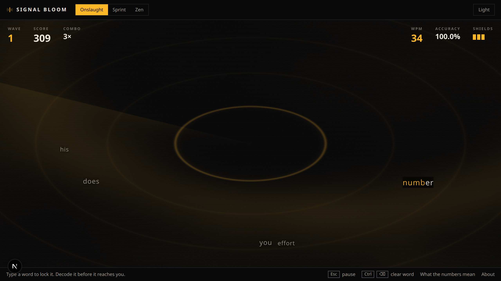
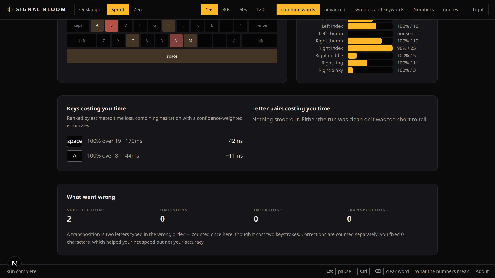

<div align="center">



# Signal Bloom

**A typing game that measures how you actually type.**

[](https://github.com/manojkumargogula/signal-bloom/actions/workflows/ci.yml)
[](LICENSE)
[](.nvmrc)
[](CONTRIBUTING.md)

### ▸ [Play it](https://manojkumargogula.github.io/signal-bloom/)

</div>

---

Signal Bloom is a free, open-source browser typing game. Play a wave-based
typing roguelite or a standard timed test, then read your net WPM, raw WPM,
accuracy, consistency, per-key heatmap and problem bigrams. There is no
account and no server: every run stays in your browser.

## Three ways to play

**Onslaught** — the game. Words arrive as transmissions closing on your
position from the rim of a radar scope. Your first keystroke locks the nearest
one; decode it before it breaches the perimeter. Clear a wave and you salvage
one of three relics that change the rules for the rest of the run. There are
14 of them and they stack, so the point of a run is the build you end up with.

**Sprint** — the honest typing test. 15, 30, 60 or 120 seconds over common
words, advanced vocabulary, code symbols, numbers or public-domain quotes.
Nothing chases you. This is the mode that sets your records.

**Zen** — untimed, no score, no fail state. Type until you stop.

## What it measures



Every figure is derived from a log of individual keystrokes at the end of a
run, never accumulated while you type — so the results screen cannot drift
from what you actually pressed.

| | |
|---|---|
| [**Net and raw WPM**](https://manojkumargogula.github.io/signal-bloom/metrics/#wpm) | What you produced, and what you typed including the mistakes. The gap is what errors cost you. |
| [**Accuracy**](https://manojkumargogula.github.io/signal-bloom/metrics/#accuracy) | Judged the moment you press each key. Backspace never repairs it. |
| [**Consistency**](https://manojkumargogula.github.io/signal-bloom/metrics/#consistency) | How evenly you held your pace, second by second. Often the number worth improving first. |
| [**Per-key heatmap**](https://manojkumargogula.github.io/signal-bloom/metrics/#heatmap) | Which keys you miss, attributed to the key you *needed* rather than the one you hit. |
| [**Per-finger load**](https://manojkumargogula.github.io/signal-bloom/metrics/#fingers) | How much work each finger did, and how well it did it. |
| [**Problem bigrams**](https://manojkumargogula.github.io/signal-bloom/metrics/#problem-bigrams) | The letter pairs costing you the most time, in milliseconds. |

Every formula is written down at
[**/metrics**](https://manojkumargogula.github.io/signal-bloom/metrics/). A
typing score you cannot check is just a number.

## Quick start

```bash
pnpm install
pnpm dev
```

**No environment variables, no API keys, no database, no accounts, no services
to provision.** It is a static site with a game in it.

```bash
pnpm test         # Vitest — 181 tests across the engine and the metrics math
pnpm typecheck
pnpm lint
pnpm contrast     # WCAG gate over the design tokens
pnpm build        # static export into out/
```

## How it is built

Next.js static export, React 19, Tailwind v4, TypeScript, Vitest. Deployed to
GitHub Pages. No backend, by design.

```
src/engine/     the game: state, simulation, targeting, relics.
                No React, no DOM, no window — runs in plain Node under test.
src/analytics/  pure metric math. The most heavily tested code here.
src/input/      keyboard capture, on two channels.
src/render/     imperative view layers: WebGL scope, DOM stage, particles.
src/react/      the bindings between the engine and React.
src/data/       word lists and keyboard layouts.
src/storage/    localStorage schema.
```

Three decisions worth knowing, because they explain most of the code:

**The engine is not in React.** Authoritative game state lives in a plain
class. One `requestAnimationFrame` loop runs a fixed 60Hz simulation and writes
to the DOM and the canvases imperatively; the HUD subscribes to a snapshot the
engine publishes at about 10Hz, through `useSyncExternalStore` so sibling
widgets cannot tear. **While you are typing, React renders zero times.**

**Keyboard input arrives on two channels, and both are load-bearing.** Text
comes from `beforeinput` on a hidden input, because that is the only source
that is correct for dead keys, IME commits, autocorrect and Android keyboards —
which report `key: "Unidentified"`. Physical keys come from a `keydown`
listener, because that is the only source of `event.code`, which the heatmap
needs since `event.key` depends on your layout. The two are paired through a
50ms register; a character with no matching keypress is marked synthetic and
kept out of the latency statistics.

**The typing surface is real DOM, not canvas.** Canvas text discards the
accessibility tree, browser zoom, text selection and find-in-page, and renders
softer at exactly the small sizes that matter. In a game whose whole subject is
reading letterforms, that trade is not available. Depth on the scope comes from
eight quantised font-size rungs rather than a CSS scale, because scaling a
promoted compositor layer stretches its cached bitmap and the text goes blurry.

More in [CONTRIBUTING.md](CONTRIBUTING.md).

## Contributing

Three things are designed to be a single-file change, with no registration
step and nothing else to touch:

- **A word list**, in any language — one file in `src/data/words/`
- **A relic** — one object in `src/engine/relics/defs.ts`
- **A theme** — one token block in `src/app/globals.css`

Tests run over all three automatically: word lists are checked for duplicates,
Unicode normalisation and a declared source licence; relics are checked for
determinism and run through a property test that drafts hundreds of random
builds; themes are checked against WCAG AA by a script that parses the
stylesheet, so a contributed theme is safe to merge without reviewing it by
eye.

See [CONTRIBUTING.md](CONTRIBUTING.md) for the shapes and the two
architectural rules.

## Accessibility

The game is entirely keyboard-driven, so this is not decoration:

- **Modifier combinations are never intercepted.** Ctrl+T, Cmd+W and Cmd+L all
  keep working. A game that swallows browser shortcuts is broken software.
- **Tab is never bound to restart**, despite the convention on typing sites. It
  traps keyboard-only and screen-reader users inside the play area.
- **Upcoming words are not dimmed into illegibility.** They are real content
  and every text pair passes WCAG AA in both themes, enforced in CI.
- **One polite live region**, announcing wave changes only. Announcing every
  word would flood a screen reader and make the game unplayable.
- `prefers-reduced-motion` turns off the scope, the shake and the particles —
  but never entity motion, which would remove the game rather than calm it.
- Both themes ship complete. Light is a genuine re-derivation, not an
  inversion: `#FFB627` is 1.5:1 on off-white and unusable, so light uses a deep
  burnt amber instead.

## Known limitations

Stated plainly, since some of them are architectural:

- **History does not sync.** It is in `localStorage` on the device you played
  on, and clearing site data erases it. That is the cost of having no server.
- **Onslaught does not feed your long-term statistics.** You choose which word
  to answer there, so the expected character is ambiguous and statistics built
  on it would be quietly wrong. Sprint sets your records.
- **Shared links cannot show your exact numbers.** GitHub Pages has no runtime,
  so a social preview image cannot be generated per result. You can copy your
  result card as an image instead.
- **The heatmap assumes QWERTY fingering.** Physical key codes are recorded for
  every keystroke, so adding a layout is a finger map rather than a rewrite.
- **Mobile is supported, not designed for.** Sprint and Zen work on a touch
  keyboard. Onslaught expects two hands on real keys.

## Roadmap

- [ ] Dvorak and Colemak finger maps
- [ ] Career statistics across runs, with trend lines
- [ ] More word lists, in more languages
- [ ] Offline service worker
- [ ] Result card as a copyable image

## Licence

MIT. See [LICENSE](LICENSE), and [NOTICE.md](NOTICE.md) for font and asset
attribution — Chakra Petch and JetBrains Mono are both OFL-1.1.
